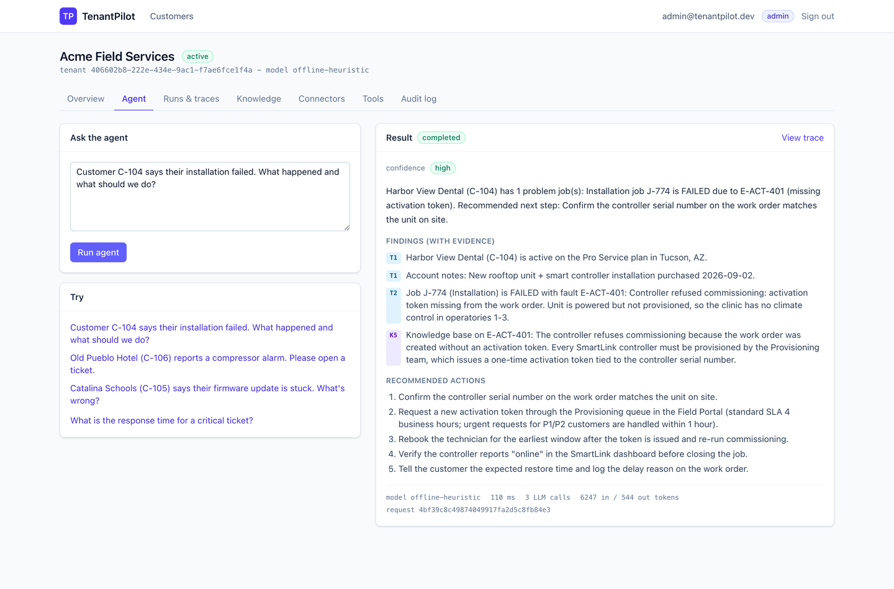
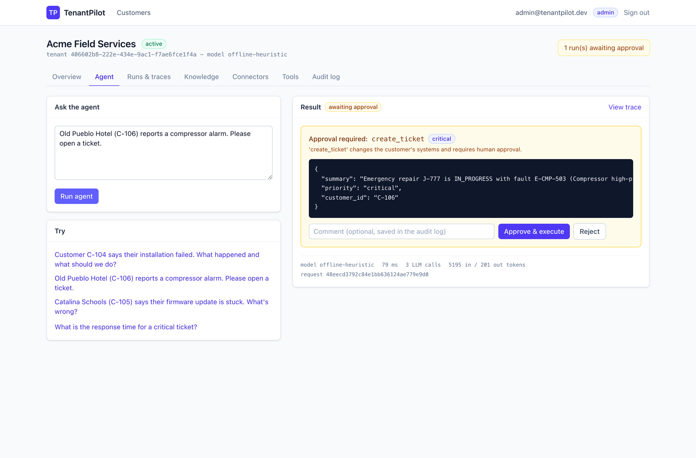
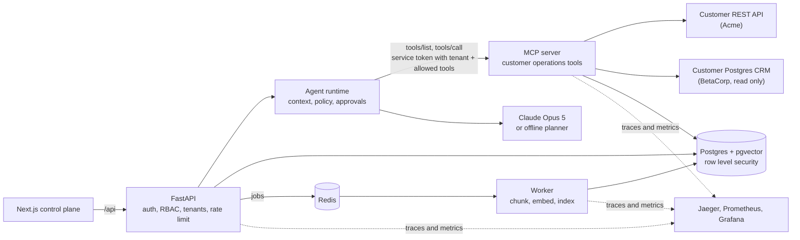
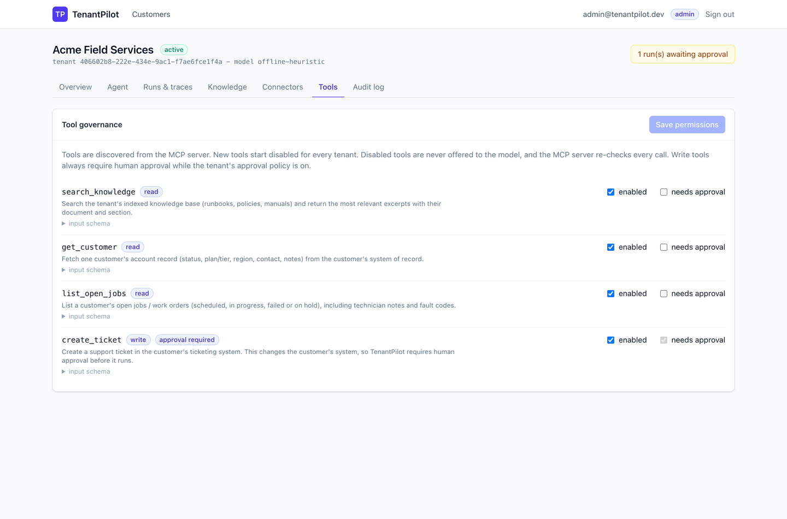
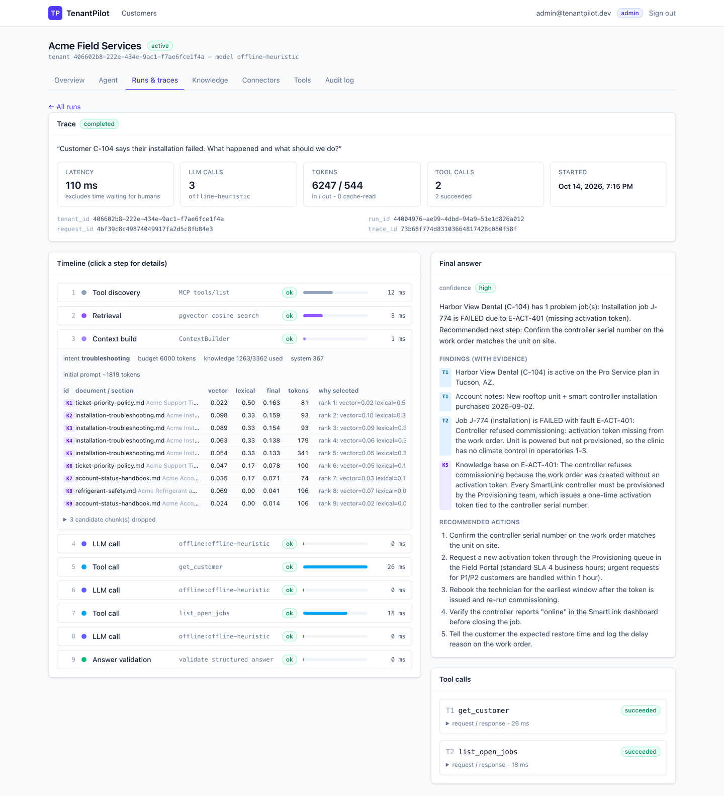

# TenantPilot

A multi-tenant platform for running AI agents against customer systems.

You add a customer, connect their API or database, upload their documents, pick which tools their agent is allowed to use, and deploy the whole thing to Kubernetes. Every request, tool call, retrieved document and human approval is visible from one control plane.

[](https://github.com/tummalapalli24/tenantpilot/actions/workflows/deploy.yml)
[](LICENSE)
[](pyproject.toml)

```bash
make up                     # one command, full stack in Docker
open http://localhost:3000  # admin@tenantpilot.dev / tenantpilot-demo
```

No API key is needed to try it. The demo tenants use a deterministic planner that speaks the same tool protocol as Claude, so the whole flow works offline.



## Contents

- [The problem](#the-problem)
- [Try it in two minutes](#try-it-in-two-minutes)
- [What happens inside one request](#what-happens-inside-one-request)
- [Architecture](#architecture)
- [How tenants are kept apart](#how-tenants-are-kept-apart)
- [How tool calls are controlled](#how-tool-calls-are-controlled)
- [How context is built](#how-context-is-built)
- [How customer systems are connected](#how-customer-systems-are-connected)
- [When things go wrong](#when-things-go-wrong)
- [What you can see while it runs](#what-you-can-see-while-it-runs)
- [Tests and evaluations](#tests-and-evaluations)
- [Running it on Kubernetes](#running-it-on-kubernetes)
- [The delivery pipeline](#the-delivery-pipeline)
- [Cloud infrastructure](#cloud-infrastructure)
- [Local development](#local-development)
- [Configuration](#configuration)
- [Repository map](#repository-map)
- [What is proven and what is not](#what-is-proven-and-what-is-not)
- [Documentation](#documentation)
- [About this project](#about-this-project)

## The problem

Most AI demos talk to one system and trust the model to behave. A real deployment is harder than that:

1. Every customer has different systems, different field names and different permissions.
2. An agent that can change a customer's data needs a person in front of the risky actions.
3. One customer must never see another customer's data, even on the day someone writes a buggy query.
4. All of it has to run somewhere, with health checks, metrics, and a way to find out at 2am what the agent actually did.

TenantPilot is a working answer to those four problems. It is small enough to read in an afternoon and complete enough to deploy.

Two demo customers ship with it:

- **Acme Field Services** keeps customers and work orders in a REST API, and its agent may open support tickets after a human approves.
- **BetaCorp Logistics** keeps the same kind of records in a Postgres database, and its agent may only read. The ticket tool is switched off for that tenant, so the model never even sees it.

Same code, same agent, two very different customers. That is the point of the project.

## Try it in two minutes

```bash
git clone https://github.com/tummalapalli24/tenantpilot.git
cd tenantpilot
make up
```

Open <http://localhost:3000> and sign in as `admin@tenantpilot.dev` with the password `tenantpilot-demo`.

Then open **Acme Field Services**, go to **Agent**, and try these three things.

**1. Ask a question that needs two systems and a document.**

> Customer C-104 says their installation failed. What happened and what should we do?

The agent looks up the customer in Acme's API, finds failed job J-774 with fault code E-ACT-401, pulls the matching section of the troubleshooting guide, and answers with the five repair steps. Every sentence in the answer carries a source tag such as `T1` for tool results or `K5` for a document chunk. Click **View trace** to see the retrieval scores, the token budget, and each tool call with its timing.

**2. Ask for something that changes the customer's system.**

> Old Pueblo Hotel (C-106) reports a compressor alarm. Please open a ticket.

The run stops. It does not create anything yet. The screen shows the exact ticket the agent wants to create, including the priority it chose and the reason. Approve it and the ticket is created in the customer's system, and the run picks up where it left off. Reject it and the agent is told it was rejected and carries on without the write.



**3. Switch to BetaCorp Logistics and ask the same kind of question.**

The agent now reads customer records from a Postgres database instead of a REST API, and the answer comes back in the same shape. Ask it to open a ticket and it will explain that it cannot, because that tool is not enabled for this tenant.

To use a real model instead of the offline planner, put `ANTHROPIC_API_KEY=...` in `.env`, run `make up` again, and change the tenant's model to `claude-opus-5` on the Overview page.

Useful extras:

```bash
make up-obs   # same stack plus Jaeger (16686), Prometheus (9090), Grafana (3001)
make down     # stop everything, keep the data
make clean    # stop everything and delete the volumes
```

## What happens inside one request

This is the whole flow for the C-104 question above, in order.

1. The browser posts the question to the API with a JWT and a tenant header.
2. The API checks the token, checks that this user belongs to this tenant, and checks the per tenant rate limit in Redis.
3. It opens a database transaction scoped to that tenant, so Postgres row level security applies to every query that follows.
4. It asks the MCP server which tools exist, then keeps only the ones this tenant has enabled.
5. It searches that tenant's document chunks with pgvector and gets up to twelve candidates back.
6. The context builder drops weak and duplicate chunks, ranks the rest, fits them into a token budget and labels them `K1`, `K2` and so on.
7. The model gets the system prompt, the question, the selected context and the allowed tools. It replies with a structured tool call.
8. The runtime checks the tool against the tenant's permissions again, and validates the arguments against the tool's JSON schema.
9. The call goes to the MCP server with a short lived service token that names the tenant and the allowed tools. The MCP server checks that token again before it does anything.
10. The connector decrypts the customer's credential, calls their system, retries only the errors worth retrying, and maps the response into a shared data model.
11. The result comes back labelled `T1`, and the loop repeats until the model has enough to answer.
12. The answer is validated. Every claim has to cite a source that exists in this run. Unknown sources are flagged instead of shown.

Each of those steps is written to the database as a run step and sent to OpenTelemetry as a span, so you can replay a run in the UI or open it in Jaeger.

## Architecture



| Piece | What it does | Where |
| --- | --- | --- |
| Web UI | Onboarding, agent console, approvals, trace viewer | `apps/web/` |
| Control plane API | Auth, roles, tenants, connectors, documents, rate limits | `apps/api/` |
| Agent runtime | The tool loop, context building, policy checks, approvals, tracing | `services/agent/` |
| MCP server | Four customer operations tools, with its own auth | `services/mcp_server/` |
| Worker | Background document ingestion, chunking and embedding | `services/worker/` |
| Mock customer API | Stands in for a real customer system, with failure injection | `services/mock_customer_api/` |
| Shared packages | Config, database, security, secrets, retries, metrics, connectors, retrieval | `packages/` |

## How tenants are kept apart

Isolation does not depend on every developer remembering a `WHERE` clause. There are four independent layers, and each one stops a leak on its own.

1. **Membership checks in the API.** A user who is not a member of a tenant gets a 403, and an unknown tenant id gets the same answer so nobody can probe for which tenants exist.
2. **Explicit filters in the queries.** Normal, boring, and still not trusted on its own.
3. **Row level security in Postgres.** Every tenant table carries a policy that compares `tenant_id` against a transaction local setting. If a query forgets its filter, the database still returns only that tenant's rows. If the setting is missing, the policy fails closed and returns nothing.
4. **A database role that cannot turn the policies off.** The application connects as a role that is not a superuser, cannot bypass row level security and does not own the tables. Migrations run as a different role with a different password. The audit log is append only, enforced by database grants rather than by application code.

The integration tests attack all of this on purpose: wrong tenant headers, another tenant's run id, vector search with no tenant set, and an insert that tries to write a row for a different tenant.

## How tool calls are controlled

The model proposes. The code decides. A tool call has to pass four checks before anything happens in a customer's system.

1. **Is it offered?** Only tools the tenant has enabled are sent to the model. A tool that is switched off is invisible, so the model cannot ask for it.
2. **Is it allowed right now?** Permissions are read again on every turn, so revoking a tool stops runs that are already in flight. Arguments are validated against the tool's JSON schema, so a made up priority value never leaves the process.
3. **Does the MCP server accept it?** The call carries a five minute service token that names the tenant, the run and the allowed tools. The MCP server verifies the token itself. A stolen user token is rejected because it has a different audience and a different secret.
4. **Does it change the customer's system?** Tools that write are approval gated. The run pauses, its full state is saved to the database, and it resumes in a later request, possibly on a different pod.

The approval endpoint locks the run row and flips its status in the same transaction. The test fires four approvals at the same moment and expects exactly one success, three conflicts, and one ticket in the customer's system.



## How context is built

The tenant's settings cap the prompt, by default at 6,000 tokens. The context builder spends that budget and writes down why each chunk was kept or dropped, which is what makes retrieval problems debuggable.

1. Retrieve up to twice the configured top k from that tenant's HNSW index.
2. Drop anything below the relevance floor.
3. Remove exact duplicates, and near duplicates that share most of their terms.
4. Rank with a mix of vector score, word overlap and entity matches such as a customer id or an error code.
5. Fill the knowledge budget with the best chunks, and label them `K1`, `K2` and so on.

Tool results get the same treatment and are labelled `T1`, `T2` and so on. The final answer has to cite those labels, and anything it invents is flagged as unsupported rather than shown as fact.

A real run of the C-104 question looks like this: 367 tokens of system prompt, 21 tokens of question, 2,100 tokens held back for tool results, and 3,362 tokens of room for documents, of which that run used 1,263.

## How customer systems are connected

Two customers, two completely different backends, one data model.

- **REST connector.** Operations are declared as data, not code: method, path, query, where the result lives in the response, and a map from the customer's field names to ours. Path values are URL encoded so user input cannot change the endpoint.
- **Postgres connector.** Named, parameterized, single statement reads, run in a read only transaction with a statement timeout. The model supplies values. It never supplies SQL.
- **Field maps.** `customer_ref` at Acme and `account_ref` at BetaCorp both become `customer_id`. The agent, the prompts and the tests never change when a new customer arrives.
- **Credentials.** Stored encrypted with Fernet in a row level security protected table, and referenced by an id. The API returns the reference and never the secret. Environment and mounted file references are supported too, for Kubernetes secrets.

Adding a customer means writing a connector config, not writing code.

## When things go wrong

- Retries only happen for errors worth retrying: 5xx, 429, timeouts and connection failures, with backoff and a cap of three attempts. A 404 is a missing record. A 401 or 403 is a credential problem. Other client errors are not retried, because retrying will not help.
- Customer systems fail in the demo on purpose. The mock API can inject failures, and there is a test for each case.
- If the MCP server is down, the run degrades instead of crashing, and says what it could not reach.
- Rate limits are per tenant and shared across API replicas through Redis.
- Ingestion jobs are idempotent, so a retried document does not create duplicate chunks.

## What you can see while it runs

- **In the UI**: every run has a trace screen with retrieval scores, token usage, each tool call, its arguments, its timing, and approval decisions.



- **Logs**: one JSON line per event, carrying request id, tenant id, run id and trace id. API keys, bearer tokens and database passwords are scrubbed before anything is written.
- **Traces**: OpenTelemetry spans from the API, through the MCP server, into the customer API and down to SQL. The MCP protocol carries the trace context, so one agent run is one trace across two services.
- **Metrics**: Prometheus counters and histograms for runs, errors, latency, tool calls, tool failures, retrieval latency, tokens, approvals and rate limiting.
- **Dashboard**: a Grafana dashboard is provisioned with the stack, so `make up-obs` gives you charts without clicking anything.

## Tests and evaluations

```bash
make test-unit          # 54 unit tests, no infrastructure needed
make infra && make test # plus 29 integration tests against real Postgres, Redis and MCP
make evals              # 10 agent evaluation cases against a running stack
make lint helm-lint tf-validate check-migrations
```

The integration tests are the interesting ones. They start a real Postgres with pgvector, a real Redis, a real MCP server and a mock customer API, then go after the things that are easy to get wrong: cross tenant reads, forged and expired tokens, disabled tools, schema violations, the approval race, customer API failures and retry behaviour, and background ingestion.

The evaluation suite grades the agent itself: did it pick the right tools, did it avoid the forbidden ones, did it state the facts that matter, did it invent any identifiers, are its citations real, and how long did it take. The baseline run is checked in at [`evals/results/baseline-offline-heuristic.md`](evals/results/baseline-offline-heuristic.md) with 10 of 10 passing and zero invented identifiers. The deployment pipeline fails if the pass rate drops below 90 percent.

## Running it on Kubernetes

```bash
make kind-up      # local cluster, ingress, images, Helm install, smoke test
open http://localhost:8080
make kind-down
```

`make kind-up` creates a kind cluster, installs Traefik and metrics-server, builds the images, loads them into the cluster, installs the Helm chart, waits for the rollouts, runs `helm test` and then a smoke test through the ingress.

What the chart does:

- One backend image runs as four different processes: API, worker, MCP server and the migration job.
- Database migrations run as an init container before the API starts, holding an advisory lock so parallel pods cannot race.
- Liveness and readiness are separate. Readiness checks only Postgres and Redis, so a slow optional dependency never pulls a healthy pod out of service.
- The API scales on CPU with a HorizontalPodAutoscaler, and a PodDisruptionBudget keeps a pod alive during node drains.
- Network policies allow the API to reach the MCP server and the datastores, and block everything else. This was tested from inside the cluster, not just written down.
- Runtime secrets and the database owner password live in separate Kubernetes secrets. The owner password only reaches the migration init container and the seed job.
- `values.schema.json` rejects bad values at install time instead of letting pods crash later.
- Containers run as a non root user with a read only root filesystem, all Linux capabilities dropped and no service account token mounted.

The same chart targets AWS with `helm/tenantpilot/values-prod.yaml`, which points at managed Postgres, Redis and S3 instead of the in cluster ones.

## The delivery pipeline

On a pull request, [`ci.yml`](.github/workflows/ci.yml) runs six jobs in parallel: Python lint, web typecheck and build, unit tests, integration tests against real services, Helm lint plus manifest validation, and Docker builds.

On a push to main, [`deploy.yml`](.github/workflows/deploy.yml) does this in order:

1. Run the whole CI pipeline again.
2. Build the images once and push them to the GitHub container registry, tagged with the commit SHA.
3. Create a kind cluster inside the runner and install the chart with `--rollback-on-failure`.
4. Wait for the rollouts, run `helm test`, then a smoke test through the ingress.
5. Run the evaluation suite and fail the deploy if the pass rate drops below 90 percent.
6. Promote the same images to ECR and deploy to EKS, but only if the repository has `EKS_CLUSTER_NAME` set. AWS access uses GitHub OIDC, so there are no stored AWS keys.

The image that reaches production is the image that passed the tests. Nothing is rebuilt on the way.

## Cloud infrastructure

[`infra/terraform/`](infra/terraform) describes the AWS side: VPC, EKS, ECR with immutable tags, RDS Postgres with a managed master password, ElastiCache, S3 for uploads, Secrets Manager, and a GitHub OIDC role for deployments. Applications get AWS permissions through EKS Pod Identity, so no static access keys exist anywhere.

It passes `fmt` and `validate`. It has not been applied to a real AWS account, which is called out below.

## Local development

```bash
make install            # Python deps with uv, web deps with npm
cp .env.example .env
make infra migrate seed # Postgres and Redis in Docker, then roles, migrations and demo data
make api                # terminal 1
make mcp                # terminal 2
make mock               # terminal 3
make worker             # terminal 4
make web                # terminal 5
```

`make help` lists every target with a one line description.

## Configuration

Everything is read from the environment, with defaults that work on a laptop. These are the ones worth knowing.

| Variable | Default | What it controls |
| --- | --- | --- |
| `ANTHROPIC_API_KEY` | empty | Enables real Claude models. Without it, tenants use the offline planner. |
| `DEFAULT_MODEL` | `claude-opus-5` | Model used by a tenant that has not chosen one. |
| `DATABASE_URL` | local Postgres | Connection string for the restricted application role. |
| `MIGRATIONS_DATABASE_URL` | local Postgres | Connection string for the owner role that runs migrations. |
| `REDIS_URL` | local Redis | Queue and rate limiting. |
| `INGEST_MODE` | `queue` | `queue` uses the worker, `inline` processes uploads in the API. |
| `AGENT_RATE_LIMIT_PER_MINUTE` | `30` | Agent runs allowed per tenant per minute. |
| `AGENT_MAX_ITERATIONS` | `8` | Hard stop on the tool loop. |
| `SECRETS_MASTER_KEY` | generated in `.env.example` | Fernet key that encrypts connector credentials. |
| `OTEL_EXPORTER_OTLP_ENDPOINT` | empty | Set it and traces start flowing. Leave it empty and tracing is off. |

## Repository map

```
apps/api/            FastAPI control plane: routers, auth and tenant dependencies, CLI (migrate, seed, reindex)
apps/web/            Next.js 16 UI: agent console, approvals, trace viewer, onboarding
services/agent/      Agent runtime: model providers, MCP client, policy, trace recorder, the loop
services/mcp_server/ MCP server: search_knowledge, get_customer, list_open_jobs, create_ticket
services/worker/     Background ingestion: extract, chunk, embed, store
services/mock_customer_api/  Stand in for a customer system, with failure injection
packages/core/       Config, database sessions and RLS, models, security, secrets, telemetry, metrics, retries
packages/context/    Intent detection and the context builder
packages/connectors/ Connector interface, REST and Postgres connectors, field mapping, templates
packages/knowledge/  Chunking, embeddings, pgvector retrieval
packages/schemas/    Canonical customer models, connector configs, API and agent schemas
migrations/          Alembic migrations, including the row level security policies
helm/tenantpilot/    Helm chart with kind and production value files
infra/terraform/     AWS infrastructure
.github/workflows/   CI on pull requests, deployment on main
evals/               Evaluation dataset and harness
docs/                How everything is wired, and why
```

## What is proven and what is not

Honesty matters more than a long feature list, so here is the current state.

Verified by running it:

- 83 tests pass: 54 unit and 29 integration against real Postgres, Redis, an MCP server and a mock customer API.
- 10 of 10 evaluation cases pass, with no invented identifiers, both in Docker and on Kubernetes.
- The full Docker stack comes up from an empty database, including background ingestion through Redis.
- On a local Kubernetes cluster: rollouts, `helm test`, ingress, autoscaling, network policy enforcement and the approval flow in the UI.
- Distributed traces appear in Jaeger as a single trace across two services, and Prometheus scrapes the API, the MCP server and the worker.
- Workflows pass actionlint, and the Terraform passes `validate`.
- The pipeline itself. On a push to main, GitHub Actions ran the full test suite, built both images, pushed them, created a Kubernetes cluster inside the runner, installed the chart, ran `helm test`, a smoke test through the ingress and the evaluation gate, and passed every step.

Not done yet:

- Live Claude API calls. The build environment had no API key, so every run used the offline planner.
- `terraform plan` and `apply`, which need a real AWS account.
- A production EKS deployment, which is wired up but gated on an unset repository variable.

## Documentation

- [`docs/INTEGRATION_GUIDE.md`](docs/INTEGRATION_GUIDE.md) explains how each piece is wired, the reasoning behind the decisions, the bugs hit during the build, and how to talk about them in an interview.
- [`docs/wiring-guide.html`](docs/wiring-guide.html) is the same material as a visual page with diagrams. Open it in a browser.

## About this project

I built TenantPilot to practice the parts of AI engineering that are hard to practice: keeping tenants apart in a real database, putting real limits on what an agent can do, making retrieval inspectable, and shipping all of it to Kubernetes with tests that would catch a regression.

The mistakes along the way are written down in the integration guide, from a relevance threshold that silently dropped the one document chunk that mattered, to a Kubernetes image tag that never rolled out because it never changed.

## License

MIT. See [LICENSE](LICENSE).
