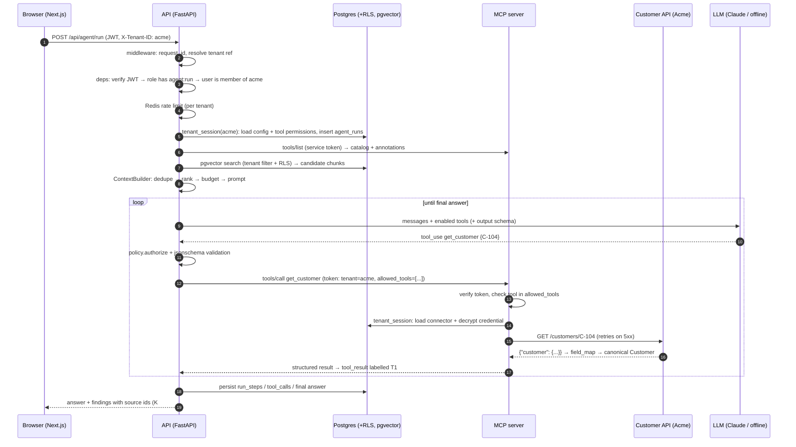

# How TenantPilot is integrated (and why)

This guide walks through every integration in the platform: what it does, how it is
wired, where the code lives, how it was verified, and what went wrong while building it.
Read it with the code open; paths are relative to the repo root.

---

## 1. One request, end to end

The question *"Customer C-104 says their installation failed. What should we do?"*
touches almost every component:



Every numbered step is written to the database as a **run step**, which is what the
trace screen shows. It is also emitted as an **OpenTelemetry span**; in Jaeger a single
run was one trace of 103 spans across `tenantpilot-api` and `tenantpilot-mcp`.

---

## 2. Tenant isolation (the most important design decision)

**Goal:** one tenant can never read or write another tenant's data, even if the
application code has a bug.

Four layers, each enough to stop the attack on its own:

| Layer | Where | What it does |
|---|---|---|
| API membership | `apps/api/deps.py` → `tenant_scope()` | The JWT lists the user's tenants. Non-members get **403**, and non-admins get 403 even for a tenant that doesn't exist, so tenant ids can't be probed. |
| Explicit filters | e.g. `packages/knowledge/retriever.py` | Queries still say `WHERE tenant_id = :tid`. |
| **Row-Level Security** | `migrations/versions/0001_initial.py` | Every tenant table has `USING/WITH CHECK (tenant_id = NULLIF(current_setting('app.current_tenant', true), '')::uuid)`. |
| Least-privilege DB role | `apps/api/cli.py` (`migrate`) | The app connects as `tenantpilot_app` (`NOSUPERUSER NOBYPASSRLS`, not the table owner). It cannot disable RLS or alter tables. |

How the tenant gets into the database session (`packages/core/db.py`):

```python
async with session.begin():
    await session.execute(text("SELECT set_config('app.current_tenant', :tid, true)"), {"tid": tid})
```

`true` = **transaction-local**. When the transaction ends, the setting disappears, so a
pooled connection can never leak tenant A's context to the next request.

Two details that only show up in practice:
* `NULLIF(..., '')`: after a transaction-local setting has been used on a connection,
  `current_setting()` returns `''` (not NULL), and `''::uuid` would *error*. With NULLIF
  the comparison is NULL, so zero rows: the policy **fails closed**.
* `FORCE ROW LEVEL SECURITY` makes the policy apply to the owner too (superusers still
  bypass RLS, which is exactly why the app never connects as one).

**Verified:** `tests/integration/test_tenant_isolation.py` (403s, RLS returns zero rows
without context, cross-tenant INSERT rejected by `WITH CHECK`, vector search can't
cross tenants, a run from another tenant is a 404). I also checked it by hand in `psql`
as the runtime role: `DELETE FROM audit_logs` → *permission denied*;
`ALTER TABLE documents DISABLE ROW LEVEL SECURITY` → *must be owner*.

---

## 3. Authentication and authorization

* **User tokens** (`packages/core/security.py`): HS256 JWT with `role` and `tenants`,
  audience `tenantpilot-api`. Passwords use `scrypt` from the standard library.
* **RBAC** is a *permission* matrix (`PERMISSIONS`), not role checks sprinkled in code:
  endpoints depend on `require("agent:approve")`, so changing who can approve is a
  one-line change.
* **Service tokens** (API → MCP) are a *different* JWT: different secret, audience
  `tenantpilot-mcp`, 5-minute TTL, and claims pinning `tenant_id` and `allowed_tools`
  for one run. A leaked user token is useless against the MCP server and vice versa
  (unit-tested).
* Login response time doesn't reveal which emails exist (a dummy hash is verified for
  unknown users).

---

## 4. Knowledge ingestion and retrieval (RAG)

```
upload → object store (tenant-prefixed key) → documents row (queued)
       → Redis/RQ job → worker: extract text → chunk → embed → document_chunks (pgvector)
```

* **Upload** (`apps/api/routers/documents.py`): size/type checks, strips client paths,
  returns **202 Accepted** immediately.
* **Worker** (`services/worker/`): RQ's forking worker on Linux (a crashing job can't
  kill the worker), `SimpleWorker` on macOS where fork is unsafe. Jobs are idempotent
  (chunks are replaced), so retries are safe.
* **Chunking** (`packages/knowledge/chunking.py`) follows document structure (headings →
  paragraphs → sentences), and every chunk starts with its heading path
  (`[Guide > E-ACT-401: Missing activation token]`). That header makes each chunk
  self-describing for both retrieval and citation.
* **Embeddings** (`packages/knowledge/embeddings.py`): a deterministic 384-dim *hashing*
  embedder, so everything runs offline and CI is reproducible. **Trade-off:** it matches
  words, not meaning. Production would plug a semantic model in behind the same
  `Embedder` protocol. The dimension is part of the schema (`vector(384)`), so switching
  models means a migration plus `python -m apps.api.cli reindex --tenant <slug>`.
* **Search** (`packages/knowledge/retriever.py`): cosine distance on an **HNSW** index.
  `SET LOCAL hnsw.iterative_scan = 'relaxed_order'` (pgvector ≥ 0.8) keeps the index
  scan going until enough rows pass the tenant filter. Without it, a filtered HNSW
  search can return fewer than `top_k` results in a big multi-tenant table.

---

## 5. Context engineering: `packages/context/builder.py`

The prompt is built by a pipeline with a token budget, not by pasting everything in:

1. **Intent + entities** (`intent.py`): troubleshooting / action / lookup / question,
   plus customer ids, job ids and error codes. Deterministic, cheap, recorded in the trace.
2. **Relevance floor**: drop candidates below a minimum vector score.
3. **Dedupe**: exact (content hash) and near duplicates (term-set Jaccard ≥ 0.85);
   the higher-scoring copy is kept.
4. **Hybrid rank**: `0.6·vector + 0.3·lexical overlap + 0.1·entity match`.
5. **Budget**: `knowledge = max_context_tokens − system − request − tool_reserve − slack`,
   filled greedily by rank.
6. **Render**: `<request>`, `<detected_entities>` and `<knowledge>` with `<source id="K1">`
   tags.

Every selected chunk carries a *reason* ("rank 2: vector=0.10 lexical=0.33 +entity
match") and every dropped one says why ("below relevance floor", "near-duplicate of…",
"over token budget"). The trace screen shows this table. **Tool results** go through
the same budget (`fit_tool_result`), are labelled `T1, T2…`, and are **redacted**
before they reach the model.

Why source ids matter: the final answer's findings must cite `K#`/`T#` ids, and
`packages/schemas/agent.py` flags any id that never existed in the run. That's a
cheap, deterministic hallucination check (the same idea ResolveAI uses for evidence).

---

## 6. MCP: the tool layer (`services/mcp_server/`)

**Server.** MCP Python SDK **v2** (`MCPServer`; v1's `FastMCP` was renamed, so checking
the installed version mattered). Four tools:

| Tool | Annotation | Backed by |
|---|---|---|
| `search_knowledge(query, top_k)` | `readOnlyHint=True` | tenant's pgvector index |
| `get_customer(customer_id)` | `readOnlyHint=True` | tenant's connector (REST *or* Postgres) |
| `list_open_jobs(customer_id, limit)` | `readOnlyHint=True` | tenant's connector |
| `create_ticket(customer_id, summary, priority)` | `readOnlyHint=False` | tenant's connector |

* Tool signatures use `Annotated[..., Field(...)]`, so the SDK generates JSON input
  schemas (with enums such as `priority`) *and* output schemas from the Pydantic return
  types. Clients get structured content.
* **Auth** uses the SDK's own `TokenVerifier` + `AuthSettings`. Requests without a valid
  service token get HTTP 401 before any MCP processing. The verifier puts the JWT claims
  into `AccessToken.claims`, and every tool calls `caller_claims(tool)`, which rejects a
  tool not listed in the token (**defense in depth**: the runtime already filtered it).
* **Errors:** anticipated failures raise `ToolError`, and the model sees the message
  ("customer's system is unavailable…after 3 attempts"). Any other exception is a crash
  and the model only sees "Error executing tool X". Internals never leak.
* `stateless_http=True, json_response=True`: any replica can serve any request, so the
  Deployment scales behind a plain Service. DNS-rebinding protection allows only the
  service hostnames; I checked the SDK source to confirm it covers `/mcp` only, so
  Kubernetes probes on `/health` (Host = pod IP) still work.

**Client** (`services/agent/mcp_gateway.py`): `mcp.Client(streamable_http_client(url,
http_client=httpx2.AsyncClient(headers={"Authorization": ...})))`. `catalog()`
normalizes `tools/list` (cached for 60s): `read_only` comes from `readOnlyHint`, the risk
label from tool `_meta`. **New tools appear automatically but are disabled for every
tenant** until an admin enables them.

**Trace propagation across MCP is free:** the SDK injects W3C trace context into the
JSON-RPC `_meta` field, and the server extracts it. I found this by reading the SDK
source, and Jaeger confirmed one trace spanning both services.

---

## 7. The agent runtime (`services/agent/runtime.py`)

A **manual tool-use loop**, chosen over an SDK tool runner for one reason: a run must be
able to *stop* at an approval gate and *resume* minutes later, in a different HTTP
request and possibly on a different pod. So after each turn the whole transcript
(content blocks, including thinking blocks, which are replayed unchanged) is stored in
`agent_runs.state`.

Per turn:
1. `provider.complete(system, messages, tools, output_schema)`
2. For each `tool_use`: **policy** (`policy.py`, permissions re-read every turn so a
   revoked tool stops working mid-run) → **argument validation** against the MCP JSON
   schema (`priority: "URGENTTT"` is rejected before any network call) → execute, or
   **pause** for approval.
3. All tool results go back in **one** user message (the API expects parallel results
   together).
4. No tool calls → parse and validate the final JSON answer → `completed`.

**Approval race:** `decide()` does `SELECT ... FOR UPDATE` on the run, checks
`awaiting_approval`, and flips it to `running` *inside the same transaction*. The
integration test fires four approvals at once: exactly one executes, three get HTTP 409,
and the customer's system receives exactly one ticket.

Other guards: an iteration cap (8), a `refusal` stop reason becomes a controlled
failure, `max_tokens` truncation is caught, the MCP server being down means *degraded
mode* (knowledge-only answer, recorded in the trace), and a tool revoked between
request and approval is **denied** at execution time (tested).

---

## 8. The LLM layer (`services/agent/llm/`)

* `base.py`: a provider-neutral interface using Anthropic-shaped content blocks.
* **Claude** (`anthropic_provider.py`, Anthropic Python SDK 1.x), default model
  `claude-opus-5`. The provider consults a **capability table** (`models.py`) because
  tenant config must be *model-aware*:
  * `temperature`: SDK 1.x removed it from the typed signature, and Opus 5 / Sonnet 5
    reject it with a 400. It's sent via `extra_body` only to models that accept it
    (Haiku 4.5); otherwise it's dropped and the trace says so.
  * `output_config.effort` (per-tenant reasoning effort), `output_config.format` (final
    answer constrained to a JSON schema), `thinking={"type":"adaptive","display":"summarized"}`
    (the trace shows a reasoning summary).
  * `fallbacks="default"` (beta) on Opus 5: a safety-classifier decline is re-run
    server-side on the recommended fallback model instead of failing the run.
  * Top-level `cache_control` for **prompt caching**: each loop iteration resends the
    same tools + system prompt, so later calls hit the cache (`cache_read_tokens` is
    shown in the trace).
  * Typed exceptions are mapped to retryable/non-retryable errors; the SDK already
    retries 429/5xx.
* **Offline planner** (`offline_provider.py`): a deterministic, rule-based stand-in that
  reads and writes the *same* transcript format. It isn't AI. It exists so CI, demos and
  eval baselines run with no API key and give identical results every time, while
  exercising the real policy, MCP, approval and tracing code.

*Not verified:* no live Claude call was made during the build (no API key in this
environment). Request shaping is unit-tested against a mocked SDK client.

---

## 9. Customer integrations (`packages/connectors/`)

One interface (`base.py`): `supports(op)`, `health_check()`, `execute(op, payload)`.
Tools ask for a canonical *operation*; the tenant's connector config decides how it is
done.

* **REST** (`rest.py`) is declarative. Per operation: method, path template (values
  URL-encoded, so `../admin` can't change the endpoint), query, body template, result
  path, and a **field map** from the customer's JSON to canonical models
  (`customer_ref → customer_id`, `site.region → region`). Failure policy:
  5xx/429/timeouts are retried with backoff and stop at `max_attempts`; 404 → `not_found`;
  401/403 → `unauthorized`; other 4xx are never retried.
* **Postgres** (`postgres.py`, BetaCorp): the model never writes SQL. Each operation is a
  *named, parameterized, read-only* query ($1…) defined by an engineer, validated to be a
  single `SELECT/WITH`, run in `readonly` transactions with a `statement_timeout`, as a
  SELECT-only DB role.
* **Onboarding** (`templates.py`): *Create customer* with an API base URL uses the
  field-service REST preset; mappings are edited later in the Connectors tab. Acme (REST
  v1) and BetaCorp (Postgres CRM) use **different backends and schemas behind the same
  `get_customer` tool**. That's the "adapt to each customer without changing the agent"
  story.
* **Secrets** (`packages/core/secrets.py`): connectors store a *reference*: `db://<id>`
  (Fernet-encrypted in the RLS-protected `secrets` table), `env://TP_CONNECTOR_*` (prefix
  enforced, so a config can't read `JWT_SECRET`) or `file://` (a mounted Kubernetes
  Secret, no path traversal). The API returns only the reference, never the value.

---

## 10. Reliability features

| Feature | Where | Verified by |
|---|---|---|
| Retry transient failures only, stop at 3, controlled message | `packages/core/retry.py`, `rest.py` | unit (`MockTransport`) + integration (mock API returns 500 → exactly 3 requests) |
| Recover when failures stop before the limit | same | integration (`http_503` ×2 then success) |
| Per-tenant rate limit, shared across replicas | `packages/core/ratelimit.py` (Redis INCR+EXPIRE) | integration |
| Fail-open if Redis blips (availability over strictness) | `routers/agent.py` | code review |
| Liveness vs readiness | `routers/health.py` | kind probes |
| Degraded mode without MCP | `runtime._prepare` | trace shows `degraded: true` |
| Idempotent migrations + advisory lock | `migrations/env.py`, `cli.py` | every API pod runs them |
| Suspended tenant can't run agents | `deps.tenant_scope(require_active=True)` | integration |

---

## 11. Observability

* **Logs** (`packages/core/logging.py`): JSON lines with `request_id`, `tenant_id`,
  `run_id` and `trace_id` from contextvars. The MCP server logs carry the same
  tenant/run ids because they come from the service token claims. Redaction masks
  sensitive keys and scrubs token-shaped strings (Anthropic keys, bearer tokens, JWTs,
  DSN passwords) from every message.
* **Traces** (`packages/core/telemetry.py`): OTLP/HTTP export when
  `OTEL_EXPORTER_OTLP_ENDPOINT` is set. Auto-instrumented: FastAPI, httpx (connector →
  customer API), SQLAlchemy. Manual spans: `agent.run`, `agent.retrieval`,
  `agent.context_build`, `agent.llm_call`, `agent.tool_call`, `mcp.call_tool`. MCP spans
  come from the SDK.
* **Metrics** (`packages/core/metrics.py`): exactly the spec's
  `agent_requests_total`, `agent_errors_total`, `agent_latency_seconds`,
  `tool_calls_total`, `tool_failures_total` and `retrieval_latency_seconds`, plus tokens,
  approvals, connector outcomes and rate limiting. Labels are bounded (tenant slug, tool,
  status), never run ids.
* **Grafana** (`deploy/observability/grafana/`): a provisioned dashboard with success
  rate, p95 latency, requests/min, tool failures, rate-limited counts (stat tiles),
  runs by status, latency p50/p95, tool calls by tool, failures by tool, tokens,
  retrieval p95, approval decisions and customer-system outcomes.
* **Trace screen** (UI): built from `run_steps` in Postgres, so it works with no tracing
  backend at all. The OTel trace id is stored on the run to jump into Jaeger.

---

## 12. Frontend (`apps/web/`, Next.js 16)

* A same-origin proxy (`src/app/api/[...path]/route.ts`) forwards `/api/*` to FastAPI
  using `API_INTERNAL_URL`, which is read **at request time**, so one image works in
  every environment. In Kubernetes the Ingress sends `/api` straight to the API.
* Session in `localStorage`, read with `useSyncExternalStore` (hydration-safe). A 401
  clears the session and `RequireAuth` redirects.
* Pages: customers, create customer (tools come from the live MCP catalog, models from
  `/api/models`), overview/config editor (fields marked "ignored by this model"), agent
  console with approval cards, runs, trace timeline (context-selection table, LLM
  decisions, tool request/response), knowledge (upload + retrieval playground),
  connectors (test connection, add with JSON mapping), tools (governance toggles), audit
  log.

---

## 13. Containers (`docker/backend.Dockerfile`, `apps/web/Dockerfile`, `docker-compose.yml`)

* **One backend image, several process types** (api / worker / mcp / mock / migrate):
  the same tested artifact everywhere, with a different command.
* Multi-stage builds with `uv sync --frozen` for dependencies only (cached until the
  lockfile changes). Non-root UID 10001, code root-owned and read-only, and only
  `/data/uploads` writable. Next.js uses `output: "standalone"`.
* Compose: `migrate` (roles + migrations + seed) runs to completion first; the API waits
  for it and for Redis to be healthy. The `observability` profile adds Jaeger,
  Prometheus and Grafana.
* **Verified from scratch** (`down -v` then `up`): 11 containers, evals 10/10 through the
  web proxy, uploads indexed by the worker via Redis, traces from api/mcp/worker in
  Jaeger, all 3 Prometheus targets up.

---

## 14. Kubernetes and Helm (`helm/tenantpilot/`)

| Concern | Implementation |
|---|---|
| Workloads | api, mcp, worker, web, mock (demo), Postgres StatefulSet + Redis (dev only) |
| Config | ConfigMap for non-secret env; pods restart on config change (`checksum/config` annotation) |
| Secrets | **Two** Secrets: `-app` (runtime) and `-migrations` (DB owner creds, mounted *only* in the migrate initContainer and the seed Job). Generated on first install and **kept on upgrade** via `lookup`, so an upgrade never rotates the JWT key or the encryption key. `existingSecret` for External Secrets in prod. |
| Probes | startup + liveness (`/api/health`) + readiness (`/api/ready`) |
| Resources | requests/limits everywhere |
| Scaling | HPA (autoscaling/v2) on the API; PDB `minAvailable: 1`; rolling update `maxUnavailable: 0`; `preStop sleep 5` |
| Migrations | initContainer runs `cli migrate` (waits for the DB; an advisory lock serializes concurrent pods) |
| Security | non-root, read-only root FS, `drop: [ALL]`, seccomp RuntimeDefault, no service-account token mounted, **NetworkPolicies** (only api pods reach MCP; only backend pods reach Postgres/Redis) |
| Ingress | `/api` → API, `/` → web; `/metrics` deliberately not exposed |
| Guardrails | `values.schema.json` rejects bad values at `helm install` time |
| Environments | `values.yaml`, `values-kind.yaml`, `values-prod.yaml` (RDS/ElastiCache/S3, TLS, no demo data) |

**Verified on kind (Kubernetes v1.37):** all rollouts complete, `helm test` passes, UI and
API reachable through Traefik, the HPA reads live CPU metrics (it scaled 4 → 2 once load
dropped), evals 10/10 through the ingress, and the full approval flow clicked through in
the UI. **NetworkPolicy enforcement was tested**, not just declared: api → mcp is allowed,
web → mcp and web → postgres time out, and a control check (web → api, web → mock)
succeeds.

---

## 15. CI/CD (`.github/workflows/`)

* **`ci.yml`** (pull requests, and reused by deploy): ruff lint/format, web
  typecheck/lint/build, unit tests, integration tests against **Postgres + Redis service
  containers**, an `alembic check` migration-drift gate, `helm lint` + `kubeconform` for
  every values file, and Docker builds with the GitHub Actions cache.
* **`deploy.yml`** (main): CI → build and push both images to GHCR tagged with the
  **commit SHA** → create a kind cluster *inside the runner* → load those exact images →
  `helm upgrade --install --rollback-on-failure --wait` (Helm 4's replacement for
  `--atomic`) → rollout status → `helm test` → smoke test through the ingress → **eval
  gate** (the deploy fails below 90% pass rate; report uploaded as an artifact) → pod
  logs on failure.
* **Optional EKS job:** runs only when the `EKS_CLUSTER_NAME` repo variable exists, behind
  a `production` environment (add required reviewers). It authenticates to AWS with
  **GitHub OIDC** (no stored AWS keys) and **promotes the same image digest** that
  passed kind to ECR.

*Verified:* `actionlint` passes; every step's commands were run locally (same Helm
version, same kind flow, same eval gate). *Not yet verified:* an actual run on GitHub,
which happens when you push the repo.

---

## 16. Terraform (`infra/terraform/`)

VPC (3 AZs; public/private/database subnets), **EKS** (managed node group, add-ons
including the Pod Identity agent and metrics-server), **ECR** (immutable tags, scan on
push, lifecycle policy), **RDS Postgres 16** (private, encrypted, Multi-AZ in prod, and
**RDS-managed master password**, so it never appears in code or state), **ElastiCache**
(TLS + at-rest encryption), **S3** (versioned, encrypted, public access blocked, TLS-only
policy), **Secrets Manager** (app secrets for External Secrets), **EKS Pod Identity**
role for S3 (no static keys), and a **GitHub OIDC deploy role** scoped to
`repo:<you>:environment:production`.

*Verified:* `tofu fmt` + `tofu init` + `tofu validate` pass against the real module and
provider versions (AWS provider 6.66, EKS module 21.25, VPC module 6.7). *Not verified:*
`plan`/`apply` (no AWS credentials here). Per the project spec, don't claim Terraform on
your résumé until you've run `plan` and `apply` yourself. Budget roughly $200+/month
while running, and run `destroy` afterwards.

---

## 17. Tests and evaluation

**83 tests** (`make test`):
* 54 unit: ContextBuilder (floor, dedupe, entity boost, budget), intent, policy,
  argument validation, answer parsing and citation checks, connector mapping, URL
  encoding, retry semantics (retryable vs not), JWT audiences, the RBAC matrix,
  redaction, secret-ref restrictions, Claude request shaping per model, the offline
  planner sequence, chunking and embeddings.
* 29 integration (real Postgres/pgvector, Redis, MCP server and mock API as
  subprocesses): onboarding in one call, RBAC, audit, tenant isolation, MCP auth and
  defense in depth, the full approval flow, rejection, **concurrent approvals**, disabled
  tools, 500-retry, transient recovery, revoked-before-approval, missing API key,
  suspended tenant, rate limiting and ingestion.

**Evals** (`evals/run_evals.py`) grade the *process*, not just the prose: tool recall,
forbidden tools (for example, the agent must never call `create_ticket` for BetaCorp),
expected facts, **unsupported identifiers** (any C-/J-/E-/TCK- id in the answer that
appears in no tool result, context or question), citation validity, tool success and
latency. The offline baseline is 10/10. Run it again after switching a tenant to
`claude-opus-5` to compare.

---

## 18. Bugs I hit, and what each one teaches

| Symptom | Root cause | Fix | Lesson |
|---|---|---|---|
| Seeding failed: `expected list or ndarray` | pgvector's SQLAlchemy type already serializes vectors to text; the registered asyncpg binary codec wanted a list | Removed the codec registration | Two layers "helping" with the same type conversion conflict |
| Answers had no resolution steps | Relevance floor 0.05 was tuned for semantic scores; the lexical embedder scored the steps chunk 0.048 | Floor 0.02, bigger section-preserving chunks | Thresholds are embedder-specific. **The trace showed exactly which chunk was dropped and why.** |
| Tool steps showed 0 ms | The trace step timed the bookkeeping, not the batched MCP call | The recorder accepts a measured duration | Measure the thing you label |
| Eval failure on the policy question | The planner answered from the top-ranked chunk only; the right chunk was K2 | Extractive QA over all evidence | Evals + traces localize failures to a stage (retrieval was fine, synthesis wasn't) |
| "late" matched "related" | Substring intent matching | Word-boundary prefix regex |, |
| (Design review) readiness probe called MCP | A slow optional dependency would fail the probe and pull healthy pods | Readiness checks only DB + Redis | Readiness means *can serve traffic*; optional dependencies degrade instead |
| `docker compose build` → "image already exists" | 5 services each declared `build:` for the same tag and raced | Only `migrate` builds; the rest reuse the image | One artifact, one build |
| Worker spans missing in Jaeger | RQ's work-horse is a forked child that exits before the BatchSpanProcessor exports | `force_flush()` at the end of each job | Short-lived processes must flush telemetry |
| Pods crash-looping on kind | `environment: kind` wasn't allowed by the app's settings validation | Allowed it + **`values.schema.json`** | Fail fast at startup is good; failing at `helm install` is better (shift left) |
| New image not rolled out | The mutable tag `local` left the pod template unchanged | Unique tag per build; CI uses the SHA; ECR tags immutable | Kubernetes rolls on spec changes, not on image content |
| `-f: command not found` from the deploy script | I edited the script while bash was executing it | Don't edit running scripts | Bash reads scripts incrementally |
| ingress-nginx chosen at first | The project was **archived in March 2026** | Traefik v3 | Check the maintenance status of dependencies |
| API drift everywhere | MCP SDK v2 renamed `FastMCP`; Anthropic SDK 1.x dropped `temperature` and moved to `httpx2`; GitHub Actions are several majors ahead; Helm 4 renamed `--atomic` | Read installed source / registries before writing code | Verify versions instead of trusting memory |
| Seeded connector URL wrong in Compose | The laptop seed stored `localhost` URLs | Seed *converges* connector URLs to the environment | Idempotent seeds should converge, not just skip |

---

## 19. Mapping to the project spec

| Spec item | Status |
|---|---|
| FastAPI, Postgres, RAG, one MCP server, three+ tools, tenant isolation | Done (4 tools, RLS) |
| Docker, Docker Compose (one command) | Done, verified from scratch |
| Kubernetes, Helm, probes, resources, HPA | Done, verified on kind |
| GitHub Actions (PR + main pipelines) | Written, actionlint-clean, steps verified locally; first real run on push |
| Basic traces → OpenTelemetry + Grafana | Done (Jaeger, Prometheus, Grafana) |
| Tests (unit, integration, security, failure) | 83 passing |
| Approval workflow, RBAC, audit logs, rate limiting, secret manager | Done |
| Evaluation dataset + dashboard | 10 cases + harness + CI gate; Grafana for runtime metrics |
| Connector SDK | `Connector` interface + REST/Postgres + declarative mapping |
| Terraform | Written and validated; **not applied** |
| Cloud deployment | Pipeline ready (EKS job); **not executed** |
| Demo video / screenshots | Yours to record (see §21) |

---

## 20. Résumé bullets (only what is implemented and verified)

- Built **TenantPilot**, a multi-tenant AI deployment platform that onboards customers,
  integrates their REST APIs and Postgres systems through a declarative connector layer
  and an MCP server, and runs a configurable tool-using agent with pgvector retrieval,
  per-tenant tool governance and approval-gated write actions.
- Enforced tenant isolation with **Postgres Row-Level Security**, a least-privilege
  runtime role and scoped service tokens between the agent runtime and the MCP server.
  Verified with cross-tenant attack tests and a concurrency test proving approvals
  execute exactly once.
- Containerized the platform and deployed it to **Kubernetes with Helm** (probes,
  resource limits, HPA, PDB, NetworkPolicies, schema-validated values) behind a **GitHub
  Actions** pipeline that builds SHA-tagged images, deploys to an ephemeral cluster, and
  gates releases on smoke tests and an agent eval suite.
- Instrumented agent, retrieval, tool and database paths with **OpenTelemetry**
  distributed tracing (propagated across MCP), Prometheus metrics and Grafana dashboards,
  plus an evaluation harness that scores tool selection, grounded facts and hallucinated
  identifiers.

(After you run `terraform apply` yourself, you can add: "Provisioned AWS infrastructure
(EKS, RDS, ElastiCache, S3, ECR) with Terraform using Pod Identity and GitHub OIDC
instead of static credentials.")

---

## 21. Interview story (the spec's structure)

* **Problem:** "Every customer has different systems, data shapes, permissions and
  production constraints, so a single agent can't just be pointed at them."
* **Decision:** "I separated customer configuration from the agent runtime: connectors
  map each customer's schema into canonical objects, and tools are exposed over MCP and
  discovered at runtime."
* **Challenge:** "Tool access and tenant isolation were the risks, so I enforced them
  outside the prompt, in four layers, ending with Postgres RLS and a runtime role that
  can't bypass it. The model is never the security boundary."
* **Production:** "One image, Helm, probes, HPA, NetworkPolicies, a CI pipeline that
  deploys the exact SHA it tested to a real cluster, and an eval gate."
* **AI:** "Context is a budgeted pipeline with a logged reason for every chunk, and every
  claim must cite a source id that exists."
* **Reliability:** "Traces and evals make failures reproducible. For example, the trace
  showed the retriever dropping the resolution-steps chunk at 0.048 against a 0.05 floor."

Likely follow-ups: *Why a manual loop?* (resume across requests/pods). *Why MCP?*
(discovery and a standard contract; enterprise needs still require a governance layer,
which is Project 2). *What breaks at scale?* (filtered HNSW recall, which iterative scan
helps with; per-tenant partitioning next; label cardinality; a reaper for runs stuck in
`running` after a crash).

**Demo recording checklist:** `make up` → login → Create customer (show MCP-discovered
tools) → Agent: C-104 question → trace screen (context table, tool calls, tokens,
request/trace ids) → the C-106 ticket approval → audit log → BetaCorp (Postgres
connector, ticket tool disabled) → `make kind-up` → `kubectl get pods,hpa` → Grafana.

---

## 22. Extending it

* **New customer:** Create customer (or `POST /api/tenants`), add a connector with a
  field map, upload docs, enable tools. No code changes.
* **New tool:** add a function to `services/mcp_server/server.py` with an annotation. It
  appears in the catalog, disabled for all tenants until enabled.
* **Real embeddings:** implement `Embedder`, change `EMBEDDING_DIM` plus a migration,
  then `cli reindex`.
* **Next projects:** *ToolMesh* turns `mcp_gateway.py` + `policy.py` into a standalone
  gateway (multiple MCP servers, rate limits per tool, circuit breaker, result
  processor). *ResolveAI* reuses the runtime, the approval gate and the evidence-id
  validation for Kubernetes incident triage.
